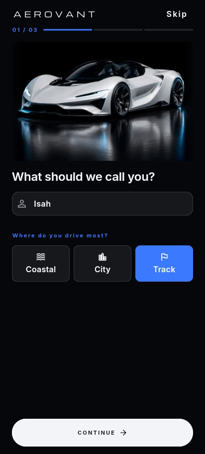
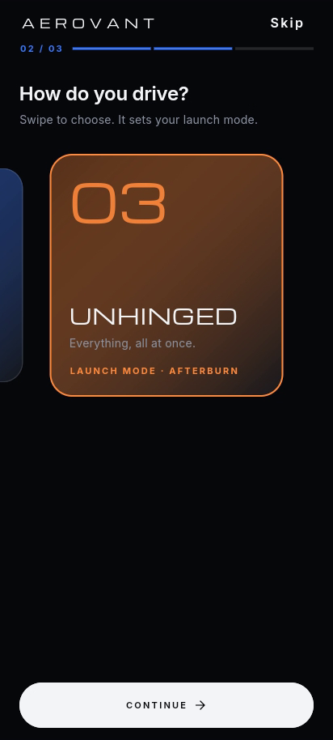
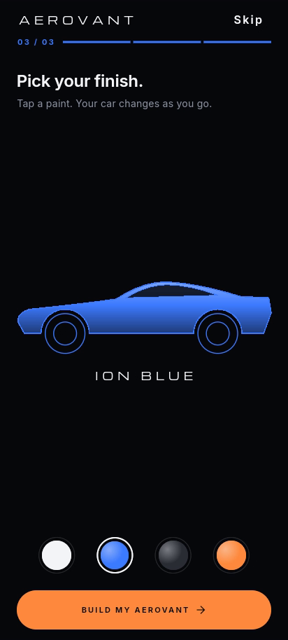
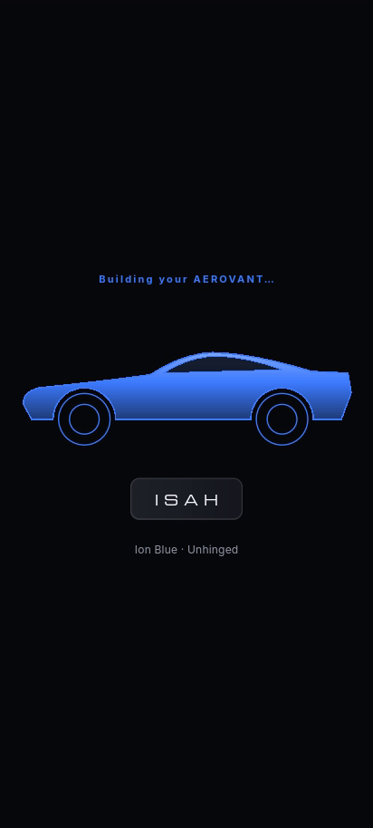
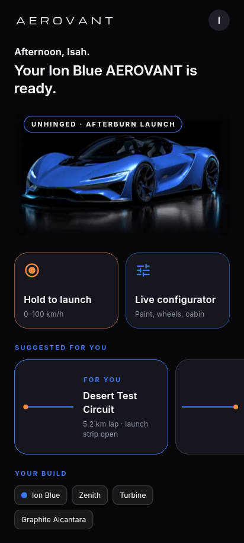
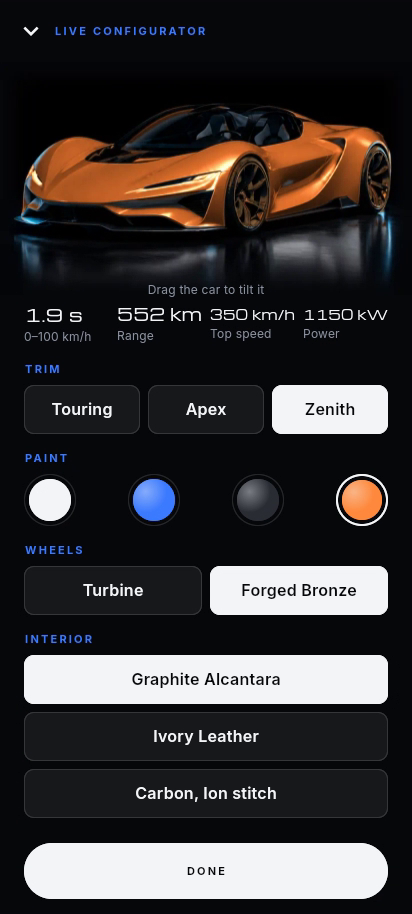
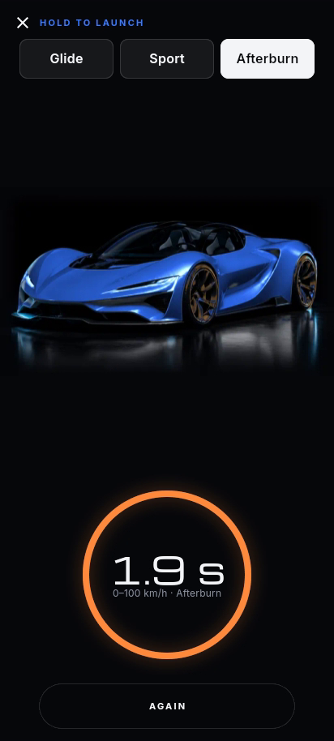
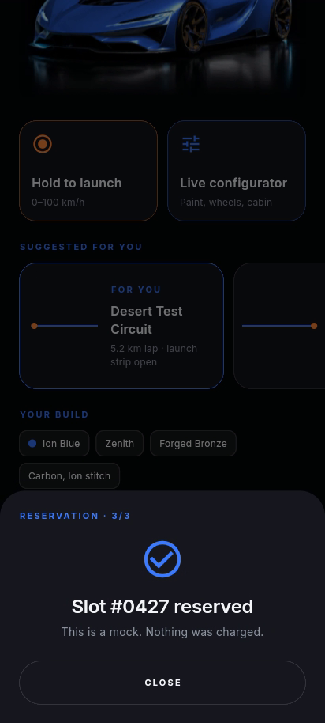

# AEROVANT · Electric Hypercar Atelier

Day 4 of my public **10-day Flutter challenge** (2026-10-22): 10 days, 10 brands, 10 apps.
**AEROVANT** is a *fictional* electric hypercar brand, "aerospace meets atelier": void black, plasma white and ion blue, with afterburn amber saved for launches. It is not a real company, it is not affiliated with any automaker, and every name, route and figure in the app is invented (including the 1.9 s launch).

Cars were suggested by **Emmanuel Oleh** in the comments on Day 3. The theme rides on the buzz around last week's hypercar reveal, without borrowing anyone's name, logo or design.

| Name + route | Driving style | Finish | Reveal | Home | Configurator | Hold-to-Launch | Reservation |
|---|---|---|---|---|---|---|---|
|  |  |  |  |  |  |  |  |

## Brand
- **Palette:** Void Black `#07080B`, Graphite `#16181D`, Plasma White `#F4F6F8`, Ion Blue `#3D7BFF`, Afterburn Amber `#FF8A3D` (launch accents only)
- **Type:** Michroma (wide geometric display, used sparingly) over Inter. Telemetry numbers use tabular figures so they never jitter. Both fonts are bundled (SIL OFL 1.1); Inter is subset to Latin and instanced to three static weights (~43 KB each).
- **Tone:** calm and confident. Short lines only.

## What's new today (vs Days 1–3)
Days 1–3 were onboarding slides → search + chips + product grid → detail. Day 4 changes the whole flow:
- **Onboarding is a questionnaire, not slides.** Three questions with a fuel-gauge progress bar and a visible **Skip** on each:
  1. "What should we call you?" A name field, plus Coastal / City / Track chips.
  2. "How do you drive?" Swipe-select cards (Serene / Spirited / Unhinged). The card that settles in the centre is the answer, and it sets the launch-mode default (Glide / Sport / Afterburn).
  3. "Pick your finish." Paint swatches recolour a vector car silhouette live (animated colour tween).
- **"Building your AEROVANT…" reveal (2.6 s):** the wireframe traces itself, fills with your paint, then your name is engraved letter by letter on the plate.
- **Skip** goes straight to home with the defaults: "Driver", Spirited, Plasma White.
- **Home is a dashboard built from your answers:** "Evening, Isah. Your Ion Blue AEROVANT is ready.", your car in your paint, a driving-style badge (e.g. UNHINGED · AFTERBURN LAUNCH), the route that matches your answer first in "Suggested for you", Hold-to-Launch and Live configurator tiles, "Your build" chips and a reservation CTA.
- **Signature: Live Launch Configurator.** Trim, paint, wheels and interior. Paint and wheel changes crossfade between renders shot from the same camera angle; drag the car to tilt it (3D rotate + parallax between the car and its colour glow, springs back on release); the spec readout (0–100 km/h, range, top speed, power) rolls to new values when the trim, wheels or interior change. Changes flow back to home.
- **Signature: Hold-to-Launch.** Press and hold: the amber ring fills over 1.4 s with a haptic tick at each quarter, then a heavy haptic, a 0→100 km/h counter with motion-blur streaks and a blurred, surging car, and the result (Zenith in Afterburn: **1.9 s**, fictional). Let go early and the ring rewinds.
- **Mock reservation sheet:** trim → deposit summary ("No payment taken") → "Slot #0427 reserved". Nothing is charged, nothing leaves the device.
- **Navigation has its own motion per destination:** the configurator rises like a garage door, the launch screen zooms in, everything else fades.

## Architecture
```
lib/
  core/        constants, demo, routing, theme (tokens), utils, widgets (AppButton, AppText, AppTextField, GlassPanel, BrandWordmark, CarSilhouettePainter)
  features/
    driver/        data (in-memory profile repo), domain (DriverProfile, DrivingStyle, RoutePreference), presentation (DriverController)
    garage/        domain (CarBuild, PaintFinish, WheelSet, Interior, Trim, LaunchMode, SpecSheet, SpecCalculator), presentation (GarageController)
    onboarding/    domain (OnboardingStep), presentation (OnboardingController, pages, widgets, demo)
    home/          data (LocalRouteRepository), domain (SuggestedRoute, HomeBriefing, HomePersonaliser), presentation
    configurator/  domain (TiltMath), presentation
    launch/        domain (LaunchPhase, LaunchMath), presentation (LaunchController, pages, widgets, demo)
    reservation/   domain (ReservationStep), presentation (ReservationController, sheet)
```
- **State management: `provider`** (ChangeNotifier), picked at random with `shuf` from {cubit, provider} for the day (riverpod and bloc were the last two). See `../state-mgmt-log.md`.
  - App-wide: `DriverController` (the onboarding answers) and `GarageController` (the car build + its computed spec), provided above the navigator because onboarding, home, the configurator, launch and the reservation sheet all read them.
  - Page-scoped: `OnboardingController`, `LaunchController` (phase + mode, initial mode from the driving style) and `ReservationController`.
- **Personalisation is pure logic:** `HomePersonaliser.brief(profile, build, routes, hour)` returns a `HomeBriefing` (greeting, headline, badge, ordered routes). It is unit-tested, and `HomeBriefing` equality means the home only rebuilds when the result actually changes.
- Answers live in app state for the session (`InMemoryProfileRepository` behind a `ProfileRepository` interface, so local storage could be swapped in without touching widgets).
- One class per file (plus two tiny private widgets). Theme tokens cover colours, spacing, radii, sizes, typography and durations.

## Performance decisions
- `const` constructors throughout. Builds are split into small widget classes, never helper methods.
- Narrow rebuilds with provider: every widget `select`s one field (each route chip selects `route == chip`, each style card selects `style == card`, the swatches select `paint`, the hero selects `build.asset`, the spec readout selects `spec`, the launch ring selects `phase`). A paint tap never rebuilds the spec readout, because paint doesn't change the `SpecSheet` and it has value equality.
- The spec is computed once per change inside `GarageController`, never in `build()`. Setters ignore no-op updates, so nothing notifies when you tap the selected option.
- Per-frame values never go through provider: the hold ring and the 0→100 counter run on `AnimationController`s in the launch view; the controller only notifies on phase changes (idle → arming → running → finished).
- Drag-to-tilt uses a `ValueNotifier<Offset>` + `ValueListenableBuilder` whose image subtree is passed as `child`, so a drag only updates two transforms. The settle-back is one `AnimationController`.
- Animations sit in `RepaintBoundary`s (silhouette, reveal, hero crossfade, tilt stage, launch stage, launch ring, route painters). The streak painter returns early when idle, and the launch stage only animates while the run controller is running, so an idle launch screen costs nothing. Pushed routes cover the home, and Flutter's route `TickerMode` pauses tickers on routes that are not visible.
- Style cards scale from the `PageController` position via `AnimatedBuilder` with a prebuilt `child`, so swiping only updates a transform.
- Images decode at display size: `SizedAssetImage` wraps assets in `ResizeImage` with a width from `ImageCacheSize` (logical size × device pixel ratio). The configurator precaches all 8 paint × wheel renders with the same keys the widgets draw with, so a swatch tap crossfades instantly; home precaches the current build; onboarding precaches the studio hero.
- Lazy, keyed lists: `CustomScrollView` with slivers on home, a horizontal `ListView.separated` (builder) of route cards keyed by route id, a keyed `PageView.builder` for the style cards, keyed swatches.
- Assets: 8 car renders as WebP at 720×410 (15–19 KB each, ~140 KB total) plus a 12 KB onboarding hero. The fade into the void-black page is baked into the images, so no runtime `ShaderMask` is needed. The car silhouette, wireframe reveal, route lines, launch ring and speed streaks are vector `CustomPainter`s (no image assets).
- Strict analysis (`strict-casts`, `strict-inference`, `strict-raw-types`, `always_specify_types`, `prefer_const_*` and more), with zero issues.
- Release APK (split per ABI, `flutter build apk --release --split-per-abi`): arm64-v8a 17.3 MB, armeabi-v7a 14.6 MB, x86_64 18.7 MB. That is about 2 MB smaller than Day 3 (arm64 19.3 MB), mostly because the visuals are vector painters and small WebP stills instead of animated films.

## Demo tour (for screen recordings)
`DemoTour.enabled` is a compile-time constant that is false unless you build with `--dart-define=DEMO_TOUR=true`. With it on, the app answers the questions (types "Isah", picks Track, swipes to Unhinged, tries Afterburn Amber then Ion Blue), plays the reveal, opens the configurator (tilts, changes paint, wheels, trim, cabin), runs Hold-to-Launch in Afterburn, then walks through the reservation mock, with no input. Normal builds never start it.

```bash
flutter run -d linux --dart-define=DEMO_TOUR=true
```

## Run
```bash
flutter pub get
flutter run            # Android device, or -d linux (412×915 window)
flutter test           # personalisation, spec/launch maths, controllers, onboarding flow widget tests
```
Runtime dependency: `provider` (MIT). Fonts: Michroma and Inter (SIL OFL 1.1). Licensed under MIT, see LICENSE.

Note: AEROVANT is a fictional brand created for this challenge. It is not a real company or product and is not affiliated with any automaker. All figures are invented. The car render is AI-generated (one generated studio image; the other paints and wheels are recolours of it, so the angle stays identical).
